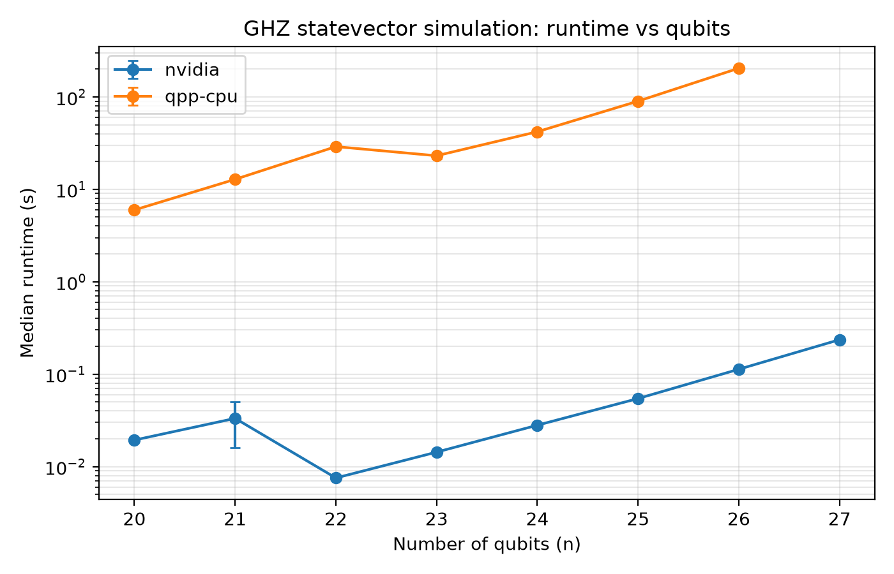
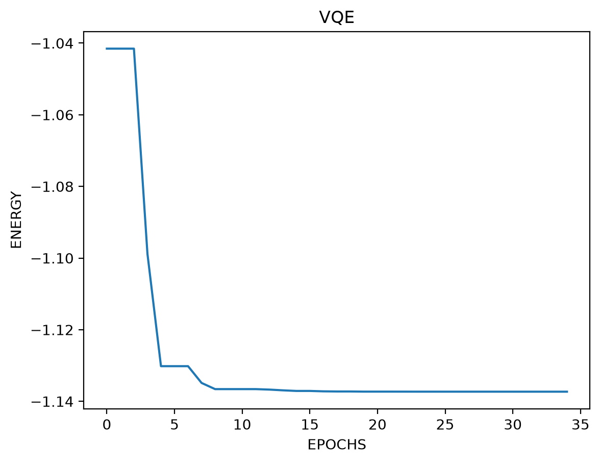
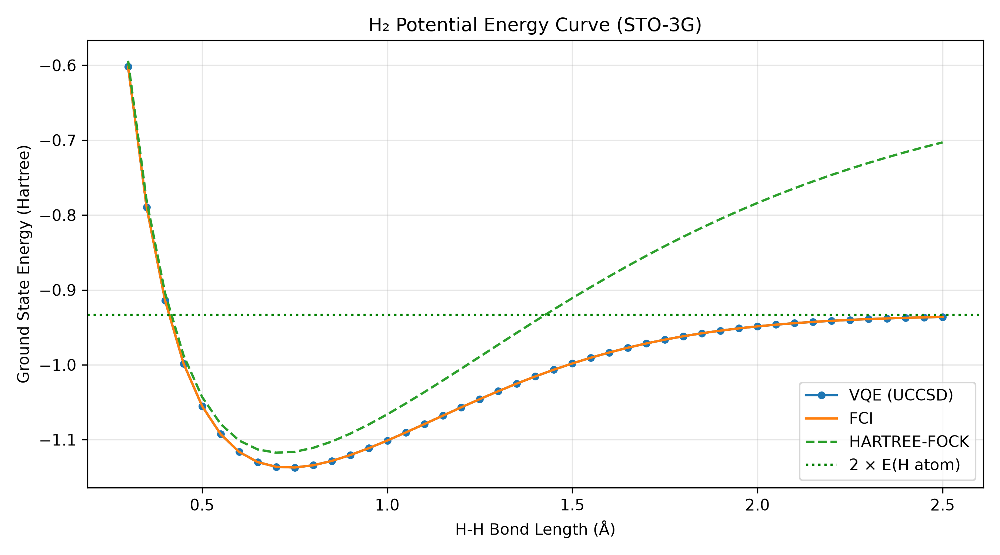
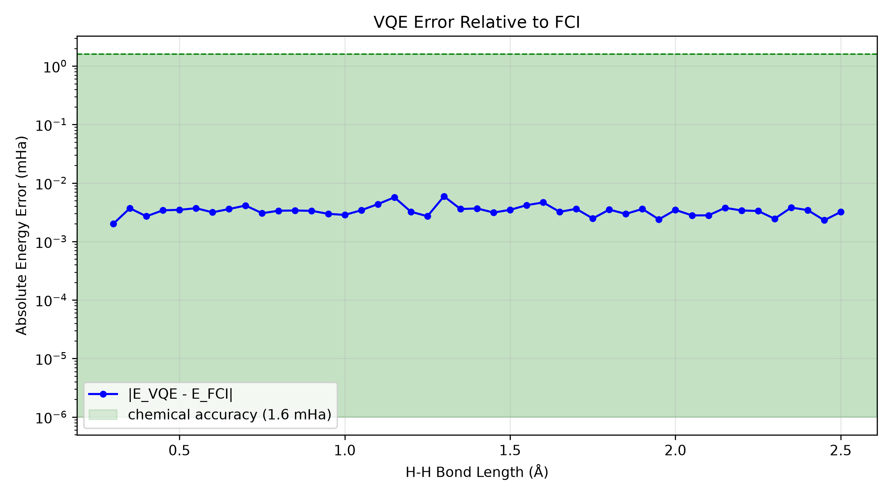

# GPU-Accelerated Quantum Simulation and VQE with NVIDIA CUDA-Q

**Summary.** This project benchmarks GPU against CPU statevector simulation in CUDA-Q on GHZ circuits, then uses the simulator to run a Variational Quantum Eigensolver (VQE) on H₂ (STO-3G). The GPU backend (`nvidia`) ran up to **27 qubits**, with a **1,807× speedup over the CPU backend (`qpp-cpu`) at 26 qubits** (the largest size timed on both). VQE with a UCCSD ansatz reproduces the H₂ potential energy curve with a **maximum error of 0.0059 mHa** against exact FCI (at 1.30 Å); all 45 geometries stay well within chemical accuracy (< 1.6 mHa). The VQE minimum on the 0.05 Å grid (45 geometries, 0.30–2.50 Å) is at **0.75 Å** with an energy of **-1.137114 Ha**.

## Results

### Part 1: CPU vs GPU statevector simulation (GHZ circuits)



| Qubits (n) | CPU (`qpp-cpu`) median | GPU (`nvidia`) median | Speedup (CPU / GPU) | Est. statevector memory (CPU / GPU) |
|---:|---:|---:|---:|---:|
| 20 | 5.975 s | 19.34 ms | 309× | 16.0 MiB / 8.0 MiB |
| 21 | 12.822 s | 33.22 ms | 386× | 32.0 MiB / 16.0 MiB |
| 22 | 28.969 s | 7.53 ms | 3,849× | 64.0 MiB / 32.0 MiB |
| 23 | 23.078 s | 14.33 ms | 1,610× | 128.0 MiB / 64.0 MiB |
| 24 | 41.972 s | 28.02 ms | 1,498× | 256.0 MiB / 128.0 MiB |
| 25 | 89.958 s | 54.47 ms | 1,651× | 512.0 MiB / 256.0 MiB |
| 26 | 204.210 s | 112.99 ms | 1,807× | 1.00 GiB / 512.0 MiB |
| 27 | — | 235.94 ms | — | — / 1.00 GiB |

### Part 2: H₂ VQE (STO-3G, UCCSD)







| Bond length (Å) | VQE energy (Ha) | FCI energy (Ha) | \|VQE − FCI\| (mHa) | Opt. time (s) |
|---:|---:|---:|---:|---:|
| 0.30 | -0.601802 | -0.601804 | 0.0020 | 6.07 |
| 0.50 | -1.055156 | -1.055160 | 0.0035 | 6.35 |
| 0.75 | -1.137114 | -1.137117 | 0.0030 | 5.94 |
| 1.00 | -1.101147 | -1.101150 | 0.0029 | 5.53 |
| 1.30 | -1.035180 | -1.035186 | 0.0059 | 5.47 |
| 1.50 | -0.998146 | -0.998149 | 0.0035 | 5.79 |
| 2.00 | -0.948638 | -0.948641 | 0.0035 | 5.32 |
| 2.50 | -0.936052 | -0.936055 | 0.0032 | 5.93 |

Raw data & additional plots (`notebooks/results/`): [`notebooks/results/ghz_benchmark.csv`](notebooks/results/ghz_benchmark.csv), [`notebooks/results/h2_error.png`](notebooks/results/h2_error.png) (linear-scale error plot).

## Why this is hard

A statevector simulator stores one complex amplitude for every basis state, so memory grows as $2^n$. At double precision (16 bytes per amplitude) 30 qubits need 16 GiB, and each extra qubit doubles that. Applying a gate means updating the amplitudes of the state, so the work per gate also grows as $2^n$. Both memory capacity and memory bandwidth become limits, which is why GPUs help (much higher bandwidth than CPUs) and why they eventually hit the same wall.

## How VQE works

1. **Molecule:** specify the geometry, basis (STO-3G), and charge/multiplicity, then compute the one- and two-electron integrals with PySCF.
2. **Hamiltonian:** build the fermionic Hamiltonian and map it to qubits with the Jordan-Wigner transform. For H₂ in STO-3G this gives 4 qubits and 15 Pauli terms (including the identity).
3. **Circuit:** prepare the Hartree-Fock state with X gates, then apply a UCCSD ansatz with variational parameters.
4. **Optimizer loop:** estimate the energy ⟨ψ(θ)|H|ψ(θ)⟩ with `cudaq.observe`, let a classical optimizer (COBYLA) update θ, and repeat until convergence. In the bond-length sweep, each point starts from the previous point's optimal parameters.

## Hardware

- **CPU:** Intel(R) Core(TM) i9-9880H CPU @ 2.30GHz (16 logical cores)
- **GPU:** NVIDIA Quadro T2000 (4096 MiB VRAM, driver 610.60)
- **CUDA-Q:** 0.16.0.post1
- **Environment:** WSL2 Ubuntu-24.04 (Linux x86_64) / Python virtual environment (`.venv`)

## How to reproduce

```bash
pip install -r requirements.txt
# Part 1: run notebooks/benchmark.ipynb         -> notebooks/results/ghz_benchmark.csv & ghz_benchmark.png
# Part 2: run notebooks/src/h2_vqe.ipynb        -> notebooks/results/h2_pes.png
#         run notebooks/src/h2_vqe_BLinc.ipynb  -> notebooks/results/h2_pes_combined.png, h2_error_log.png & h2_error.png
python make_readme.py                           # regenerates this README from notebooks/results/
```

## Limitations

- This is **classical simulation** of quantum circuits. No quantum hardware was used, and there is no claim of quantum advantage.
- **H₂ is small enough to solve exactly.** FCI in STO-3G is trivial here, so VQE validates the pipeline; it does not produce new chemistry.
- **Benchmark numbers depend on the hardware**, driver, CUDA-Q version, and the circuit used. GHZ is a simple circuit, so treat timings and speedups as specific to this setup.
- **Mixed precision comparison:** `qpp-cpu` ran in double precision (`fp64`, 16 B/amplitude) while `nvidia` ran in single precision (`fp32`, 8 B/amplitude), which halves GPU memory usage and improves memory bandwidth relative to `fp64`.
- Individual timings have run-to-run noise, especially at small n where fixed overheads (GPU initialization, kernel compilation) matter.
- VQE accuracy depends on the optimizer settings (COBYLA, iteration limit, warm starts). The sweep uses a 0.05 Å grid, so the grid minimum can differ slightly from the true equilibrium bond length.

## Résumé bullet

> Built a GPU-accelerated quantum simulation benchmark and H₂/STO-3G UCCSD-VQE pipeline in NVIDIA CUDA-Q, reaching 27 qubits on GPU with a 1,807× speedup over CPU at 26 qubits, and reproducing the H₂ potential energy curve across 45 geometries with a maximum error of 0.0059 mHa against exact FCI.
